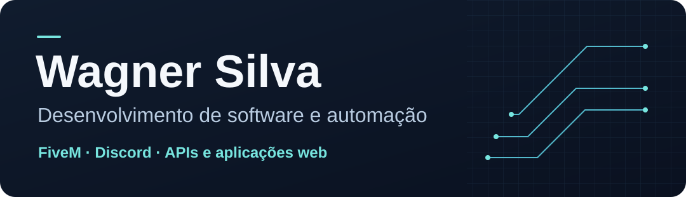

# Wagner Silva

**CEO e desenvolvedor full-stack.** Defino prioridades de produto e participo da implementação dos sistemas que sustentam a operação. Meu trabalho passa pelo front-end, pelas regras de negócio, pelas integrações e pela persistência dos dados.

**[Projetos selecionados](#projetos-selecionados) · [Liderança e produto](#liderança-e-produto) · [Competências técnicas](#competências-técnicas)**

## Projetos selecionados

### Central de operações para equipes

**Problema.** Chamados, rotinas administrativas e permissões precisam ser claros para quem opera a comunidade e para quem supervisiona o trabalho.

**Entrega.** Painel web e bots de Discord para acompanhar solicitações e executar rotinas administrativas, com acesso por cargo e registro das ações. A interface dá à equipe um ponto de consulta para o andamento e o histórico das solicitações.

**Atuação.** Estruturação dos fluxos, desenvolvimento das interfaces e integração com serviços e permissões do Discord.

### Monitoramento de atividade do servidor

**Problema.** Relatórios isolados no Discord dificultam comparar a atividade da cidade entre dias e horários.

**Entrega.** Painel que usa a mesma origem dos relatórios enviados ao Discord e coloca as séries históricas em um gráfico com filtros por período e horário. A equipe pode comparar faixas de uso no mesmo painel.

**Atuação.** Integração da fonte de dados, organização do histórico e desenvolvimento da visualização.

### Eventos e recompensas no FiveM

**Problema.** A equipe precisa operar eventos e distribuir recompensas com regras consistentes para cada jogador.

**Entrega.** Recursos em Lua para FiveM e vRP, com interface dentro do jogo, acompanhamento do progresso e regras de resgate validadas no servidor. O evento conecta a experiência do jogador à configuração administrativa e ao histórico de resgates.

**Atuação.** Desenvolvimento da interface do jogo, das regras no servidor e da integração com o inventário e a persistência.

## Liderança e produto

Como CEO, priorizo entregas considerando o impacto para os jogadores, a carga de trabalho da equipe e a manutenção do sistema. Troco tarefas repetitivas por fluxos que a equipe consegue operar e acompanhar. Quando uma decisão exige trabalho de engenharia, acompanho a entrega desde a definição das regras até a integração em produção.

## Competências técnicas

| Camada | Tecnologias e práticas |
| --- | --- |
| **Front-end** | React, TypeScript, Vite, HTML e CSS · painéis administrativos, visualização de dados e NUI |
| **Back-end** | Node.js, JavaScript e Lua · APIs REST, regras de negócio, permissões e integrações |
| **Dados** | SQL e MariaDB · persistência de progresso, históricos e configuração |
| **Plataformas e automação** | FiveM, vRP e Discord · recursos de jogo, bots, eventos e fluxos de equipe |
